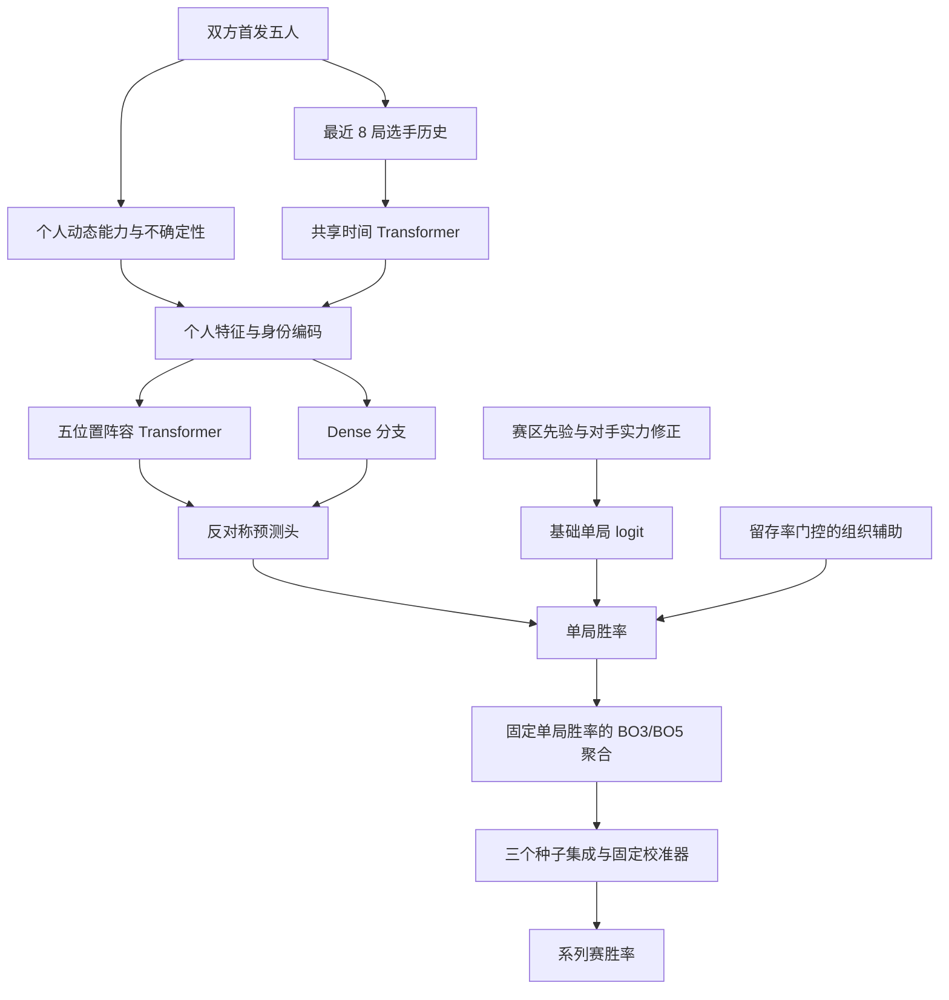

# 模型说明与复现边界

版本：2026-10-29。当前默认模型：`roster_transformer_2026_swiss_weighted`。

## 任务

在首局 BP 开始之前预测整场 BO3/BO5 的获胜概率。历史瑞士轮回放还包括 BO1；命令行预测入口目前接受 BO3/BO5。模型以选手和五人阵容为核心，队名用于查询首发、赛区与有上限的组织辅助信息。

## 结构

每个种子约 98.4 万参数，三个种子为 42、43、44。交换双方后概率互补。没有队名 ID embedding，转会不清空个人历史。组织辅助单局 logit 的绝对值上限为 0.15；全部换人后该分支关闭。

初始六赛区权重之和为 1：LCK 0.4、LPL 0.3、LEC 0.1，LCS/LCP/CBLOL 各为 0.2/3。跨赛区交手更新偏移，之后仍归一化。权重表示实力先验，不等于单场获胜概率。近期表现使用当时冻结的对手实力与预期胜率残差，避免直接比较不同赛区的原始胜率。

## 训练

1. 所有选手历史、动态评分和阵容磨合从 2026-01-01 冷启动，不引入 2024/2025 历史或旧模型。
2. 2026 年 1—8 月联赛的 3,395 个分组样本用于底座训练。9 月至 10 月 14 日的数据用于原校准，原校准样本共 61 场，较晚的验证段仅 3 场，稳定性有限。
3. 加权阶段只使用瑞士轮 R1/R2 的 16 场胜负标签。先用 R1 的 8 场训练、R2 的 8 场验证，在预设最多 60 轮中选出 24 轮；再从原底座重新开始，以全部 16 场分别微调三个种子。
4. 更新选手 embedding、Dense 和预测头；冻结 Transformer、位置/联赛编码、组织辅助、标准化器、选手词典与校准器。学习率为 3e-4，AdamW weight decay 为 0.03。
5. 固定选择原底座训练期的 256 场联赛样本作为回放池，每步抽取 32 场。原底座作为固定教师，回放只使用教师概率，不读取新的联赛真值标签。

损失为：

\[
L = \frac{10\,\mathrm{mean}(\mathrm{BCE}_{R1/R2})
 + \mathrm{mean}(\mathrm{KL}(p_{teacher}\Vert p_{student}))}{11}.
\]

10:1 是两组平均损失的系数比，不代表每条世界赛样本重复 10 次，也不保证实际梯度范数比为 10:1。此前轻微调版已经全部使用 R1/R2 样本；本版同时改变了可训练层、学习率和轮数预算，因此不能把结果变化单独归因于损失权重。

## 回顾性结果

只统计 R3/R4 的 10 场，R1/R2 已用于训练，不计入测试。

| 版本 | 命中 | Log Loss ↓ | Brier ↓ |
|---|---:|---:|---:|
| 2026 原底座 | 6/10 | 0.549851 | 0.187189 |
| 轻微调 | 6/10 | 0.549861 | 0.187194 |
| 当前加权微调 | 7/10 | 0.548813 | 0.186635 |

R3 命中从 4/8 到 5/8，G2–TES 改判 TES 并命中。R4 仍为 2/2，但 Log Loss 从轻微调的 0.380056 增至 0.411301。加权版回放中 T1 对 MKOI 胜率为 77.22%，IG 对 LYON 为 56.89%。这些是历史回放，不能作为新的赛前预测。

R3/R4 不用于梯度、选轮次或重拟合校准器；但赛果已经在先前探索中查看，所以这仍是回顾性实验。10 场不足以确认稳定提升。完整逐场结果见 [训练报告](../artifacts_roster_2026_swiss_weighted/report.md)。

## 使用限制

- 保存状态截止到 2026-10-26。日期参数不会自动下载该日期之前的新比赛；预测 10 月 29 日仍使用此快照。获取新原始数据后，应重新生成因果历史状态，并重新核验结果。
- 未提供首发时使用最后已知五人；10 月 28 日两场回放使用截至 26 日的最后已知阵容。应优先传入实际公布的首发。
- 没有英雄选择、蓝红方选边、Fearless Draft 或系列赛局间依赖建模。BO3/BO5 聚合假设每局独立且胜率固定。
- 选手身份使用 handle，缺少稳定选手 ID；同名和改名需要维护映射。长期固定五人的共同胜负不能独立识别每名选手贡献。
- BO1 回放沿用已有系列赛校准参数，没有独立的 BO1 校准验证。
- CPU 与 CUDA/bfloat16 推理可能出现小幅数值差异；保存权重和报告是训练当时的记录。

## 文件和核验

实际预测只需要当前模型目录、配置和源码。`artifacts_roster_2026/` 是重新微调和验证所需的原始底座及冻结特征。`artifacts_roster_2026_swiss/` 只保留轻微调对照表，权重已删除。

`python -m tests.validate_swiss_weighted` 检查三个保存模型的预测、冻结参数、底座哈希、标准化/校准不变、回放日期、概率互补以及未来标签隔离。反转 R3/R4 全部胜负后重新拟合，参数最大差为 0。`python -m tests.validate_release` 只使用最终模型做发布核验，不依赖预训练底座。

发布前运行了 43 项既有单元测试；清理和默认入口的新增检查以发布验证记录为准。原始训练协议中的源码哈希记录训练当时版本；发布整理只修改默认入口、文档和清理工具，不改写训练溯源记录。
